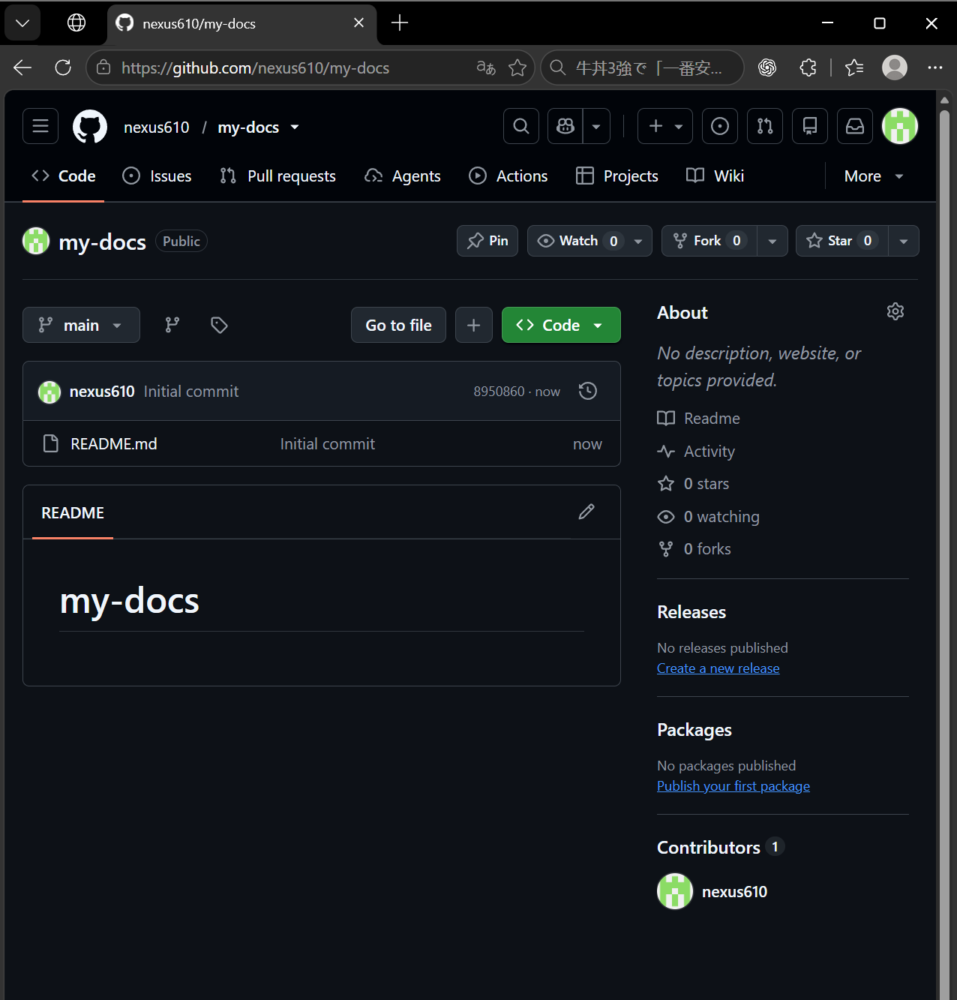
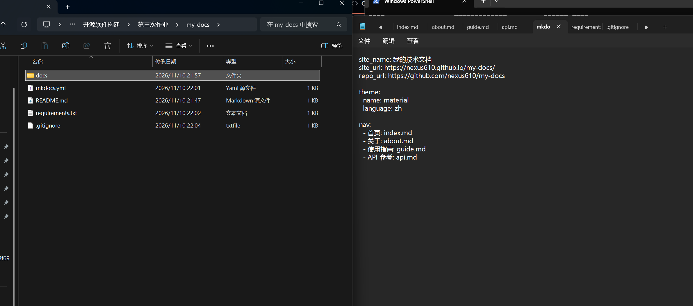
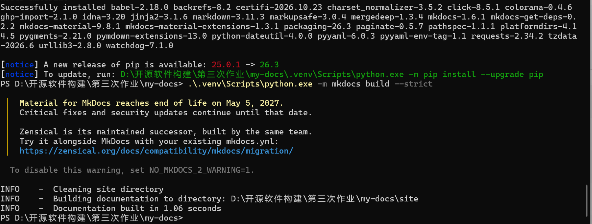
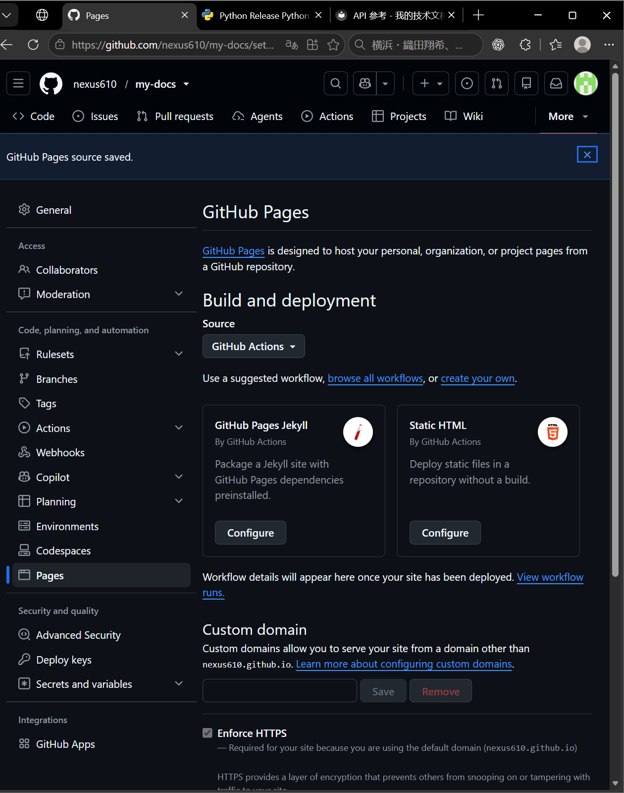
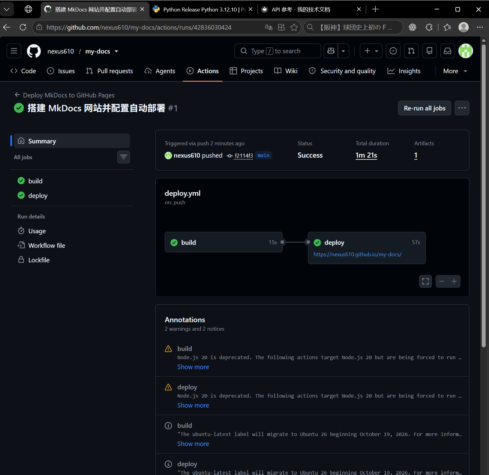
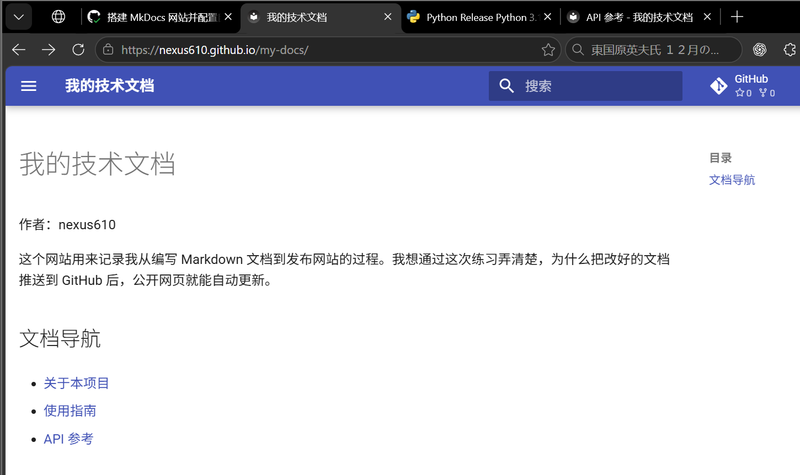
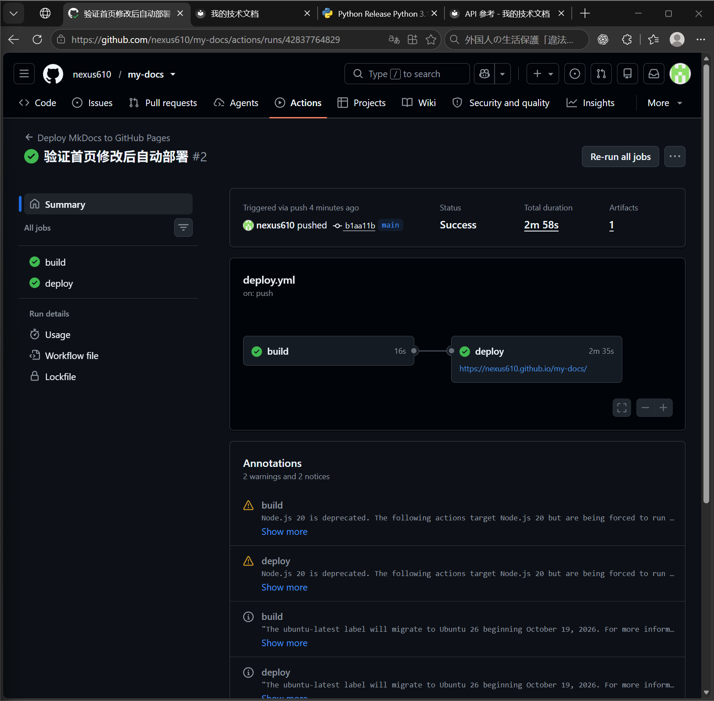
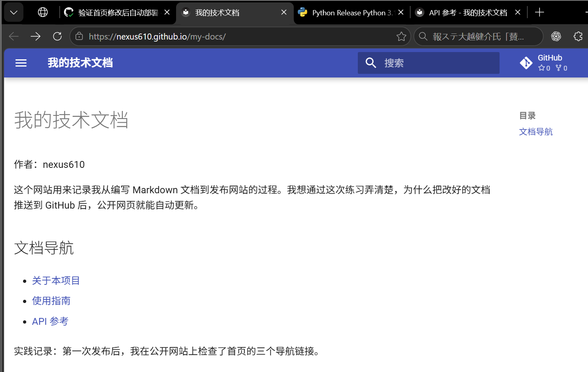

# 实践项目 2 · GitHub Pages 自动部署实验报告

## 1. 基本信息

- GitHub 登录名 `nexus610`
- [个人源码仓库](https://github.com/nexus610/my-docs)
- [公开文档网站](https://nexus610.github.io/my-docs/)

## 2. 实践过程

### 2.1 创建个人仓库

我在自己的 GitHub 账号下创建了公开仓库 `my-docs`，初始化了 README，并将 `main` 分支克隆到本地。

### 2.2 编写文档和配置

我在 `docs/` 中编写了首页、关于、使用指南和 API 参考。`mkdocs.yml` 里的 `nav` 设置页面顺序，Material 主题负责页面样式。构建时，MkDocs 会把文档转换成网页并输出到 `site/`。

### 2.3 本地构建和预览

我用 Python 3.12 创建虚拟环境，安装依赖后运行 `mkdocs build --strict`，构建成功。随后用 `mkdocs serve` 预览四个页面，检查标题、导航链接、表格和 JSON 代码块。

### 2.4 设置 Pages 发布来源

我在仓库的 Settings → Pages 中将发布来源设为 GitHub Actions，让工作流负责构建和发布网站。

### 2.5 首次构建和部署

推送提交 `f2114f3` 后，GitHub Actions 自动开始运行。`build` 构建并上传 `site/`，随后 `deploy` 将产物发布到 GitHub Pages。两个任务均成功。

### 2.6 检查公开网站

我打开了公开首页，并通过首页链接检查了关于、使用指南和 API 参考三个页面。

### 2.7 验证第二次推送自动更新

我在 `docs/index.md` 末尾添加了一句实践记录。推送到 `main` 后，Actions 自动触发第二次部署。运行成功后刷新公开首页，确认导航列表下方出现了新增文字。

- [第二次推送的提交 b1aa11b](https://github.com/nexus610/my-docs/commit/b1aa11b)
- [第二次自动部署运行记录](https://github.com/nexus610/my-docs/actions/runs/42837764829)

## 3. 遇到的问题与解决方法

本地构建成功后，我在浏览器预览时发现，首页的链接显示为普通文字，关于页的表格也没有正确排版。用 PowerShell 查看源文件后，我发现部分 Markdown 符号前多了反斜杠，表格行之间也有空行。我清理了这些字符和空行，重新写入了 API 页的 JSON 示例，再刷新页面检查显示效果。

## 4. 原理理解

1. **`docs/` 和 `site/` 有什么区别？** `docs/` 保存我编辑的 Markdown 源文件，`site/` 保存 MkDocs 生成的网页。每次构建都会重新生成 `site/`，所以应修改源文件。
2. **工作流什么时候自动运行？** 推送到 `main` 时，如果提交改动涉及 `docs/`、`mkdocs.yml`、`requirements.txt` 或部署工作流，就会自动运行。
3. **`build` 和 `deploy` 各做什么？** `build` 安装依赖、生成网页并上传产物。`deploy` 等待构建成功，再把产物发布到 GitHub Pages。
4. **只修改实验报告会触发部署吗？** 不会。`report/README.md` 不在工作流监听的路径中。
5. **为什么无需创建 `gh-pages` 分支？** Pages 的发布来源是 GitHub Actions，部署任务直接使用上传的构建产物。
